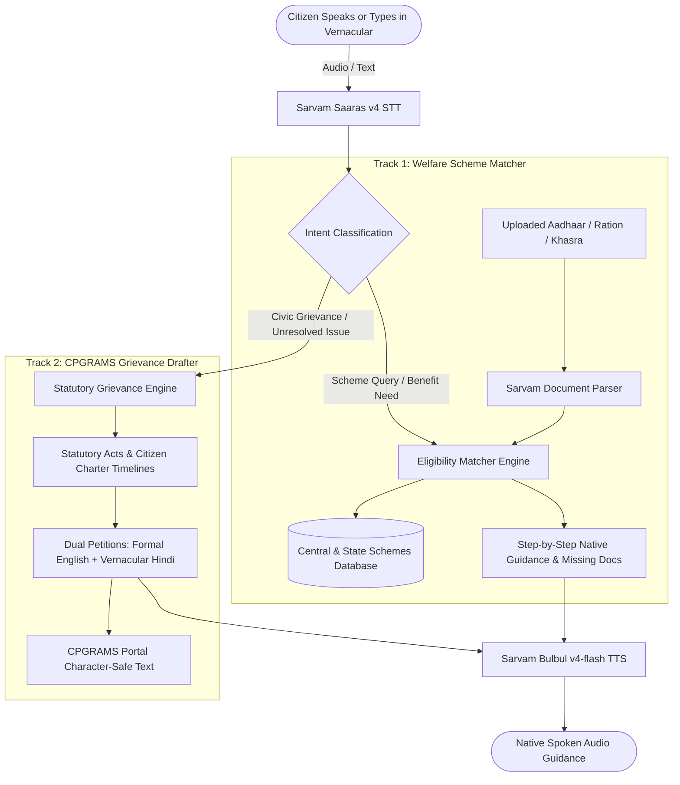

# 🏛️ Sarkari Sahayak & Grievance Drafter
> **Voice-First Indic Welfare Navigator & CPGRAMS Legal Grievance Drafter powered by Sarvam AI**

---

## 🌟 Overview
In India, millions of citizens in rural and semi-urban areas face substantial linguistic and bureaucratic barriers when accessing government welfare entitlements (like PM-Kisan, Ayushman Bharat, PMAY) or reporting civic issues (such as burnt electricity transformers, delayed pensions, contaminated water, or ration irregularities) on grievance portals like **CPGRAMS** (Centralized Public Grievance Redress and Monitoring System).

**Sarkari Sahayak** is an end-to-end multimodal AI Agent that bridges this gap using the **Sarvam AI** suite:
- **Saaras v4 (Speech-to-Text):** Transcribes spoken complaints and queries in 10+ Indian languages with native code-mixing (Hinglish/Tanglish).
- **Bulbul v4-flash (Text-to-Speech):** Speaks back step-by-step guidance, rights summaries, and answers in natural Indic audio.
- **Mayura v1 (Translation):** Bridges vernacular spoken complaints into English petitions and vice versa.
- **Sarvam-105B (Indic LLM):** Reason over government rules, extract chronology, cite statutory acts (e.g. National Food Security Act 2013, Electricity Act 2003, Citizen's Charter timelines), and generate formal administrative petitions.
- **Document Intelligence (OCR):** Scans Aadhaar, Ration Cards, and Land Records (Khasra) to automatically extract citizen profiles and match eligibility.

---

## 🏗️ Architecture & Data Flow



---

## 🚀 Key Features

1. **Multilingual Voice Console:**
   - In-browser microphone recording with 16kHz audio capture.
   - Real-time transcription into Hindi, Tamil, Telugu, Bengali, Marathi, Gujarati, Kannada, Punjabi, Malayalam, Odia, or English.
   - 1-click sample scenarios for instant testing.

2. **Official CPGRAMS Grievance Drafter:**
   - Detects the target Ministry / Department (e.g., Ministry of Power, Department of Food & Public Distribution, Ministry of Jal Shakti).
   - Injects applicable statutory citations (e.g., NFSA 2013, Electricity Act 2003 §43/§57, Banking Ombudsman Scheme 2021).
   - Generates dual output:
     - **Formal English Petition** for CPGRAMS portal and District Magistrate submission.
     - **Formal Hindi Petition** for local Tehsildar, BDO, or Gram Panchayat notice.
   - 1-click clipboard copy for portal fields and print/PDF export.

3. **Welfare Scheme Matcher:**
   - Built-in database covering PM-Kisan, Ayushman Bharat PM-JAY, PMAY, PM Vishwakarma, PM SVANidhi, Sukanya Samriddhi, Atal Pension Yojana, MGNREGA.
   - Evaluates citizen age, landholding, income, gender, and occupation with missing document checklists.

4. **Smart Document Scanner:**
   - Ingests identity documents, extracts age, landholding, income category, and auto-populates the scheme matcher.

5. **Plug-and-Play Simulation / Live Mode:**
   - Works immediately out of the box with realistic simulation mode.
   - Seamlessly connects to live `https://api.sarvam.ai` endpoints when an API key is provided in `.env` or through the in-app Settings modal.

---

## 🛠️ Tech Stack
- **Backend:** FastAPI, Python 3.10+, Uvicorn, Httpx, Pydantic
- **Frontend:** Vanilla HTML5, CSS3 (Indian GovTech Theme), JavaScript ES6, MediaRecorder API
- **AI / APIs:**
  - Sarvam Saaras v4 (`POST /speech-to-text`)
  - Sarvam Bulbul v4-flash (`POST /text-to-speech`)
  - Sarvam Mayura v1 (`POST /translate`)
  - Sarvam-105B (`POST /v1/chat/completions`)

---

## 🏃 Quick Start Guide

### 1. Prerequisites
Ensure Python 3.10+ is installed:
```bash
python --version
```

### 2. Install Dependencies
```bash
pip install -r requirements.txt
```

### 3. Configure API Key (Optional)
Copy `.env.example` to `.env` and add your Sarvam AI key:
```env
SARVAM_API_KEY=your_actual_key_here
```
*(If no key is provided, the application automatically runs in smart simulation mode for testing).*

### 4. Run the Application
```bash
python run.py
```
Open your browser and navigate to:
```
http://localhost:8000
```
